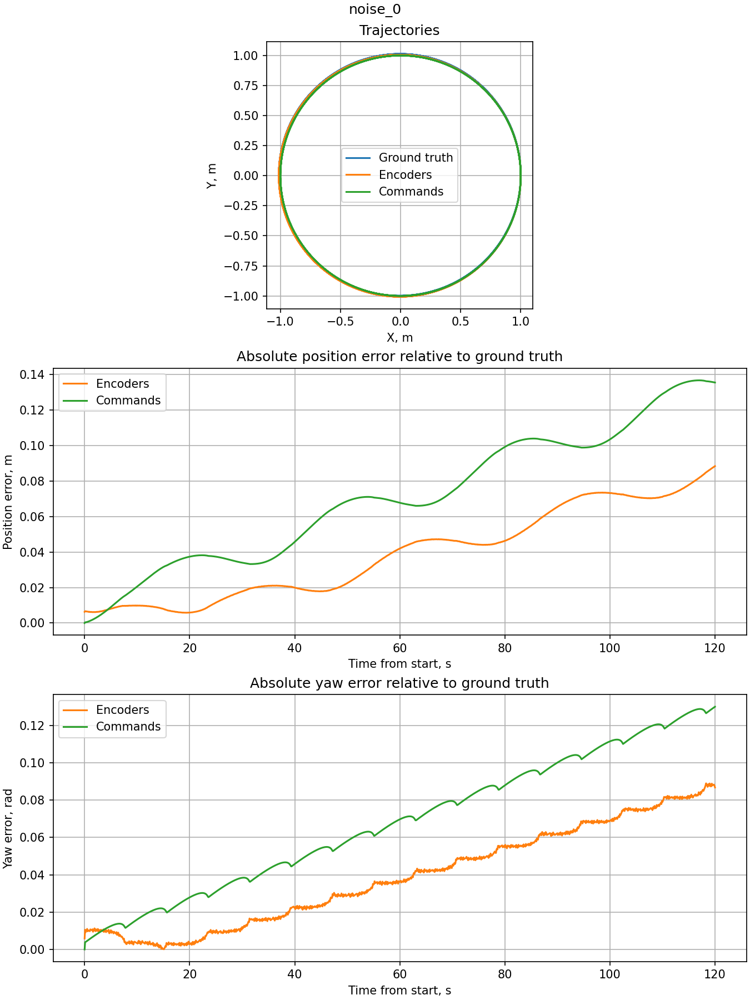
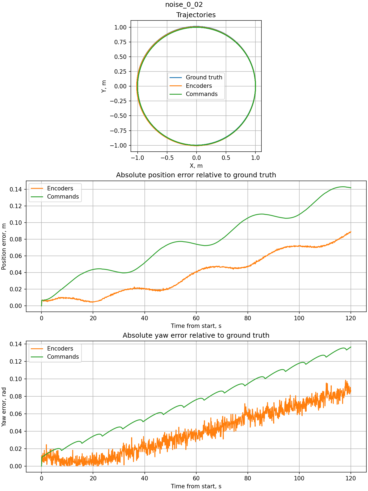
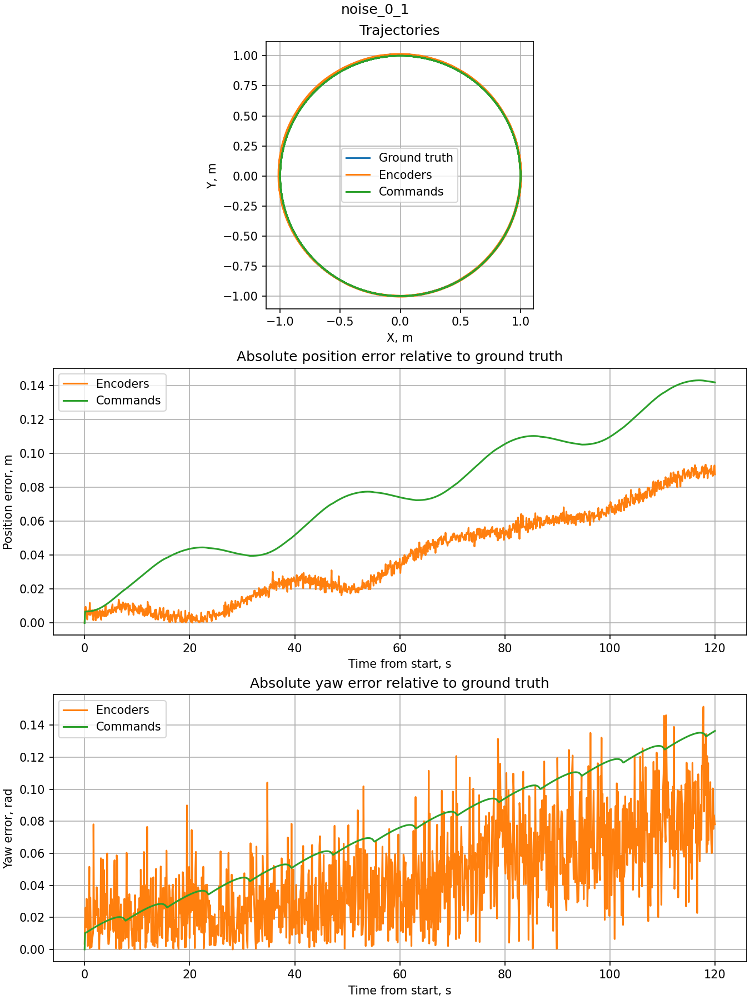

# Практическая работа 3. Одометрия

## Сборка

Команды выполняются в `zsh` внутри контейнера курса с ROS 2 Jazzy и Webots.

```bash
cd ~/practices_ws
source /opt/ros/jazzy/setup.zsh
colcon build --symlink-install --packages-select practice03_odometry
source install/setup.zsh
```

## Запуск

Если контейнер уже запущен и пакет собран, повторная сборка не нужна.
Откройте обычный терминал Ubuntu и войдите в контейнер:

```bash
docker exec -it mobile-robots-preparation-ros2-base-1 zsh
```

Затем в том же терминале подключите окружение собранного пакета:

```bash
source ~/practices_ws/install/setup.zsh
```

Запускайте эксперименты по очереди. После сохранения результатов завершите
текущий запуск через `Ctrl+C` или закройте Webots, затем запускайте следующий.
Каждый опыт начинается заново и длится 120 секунд симуляции.

```bash
ros2 launch practice03_odometry spawn_robot.launch.py world:=my_world.wbt duration:=120.0 result_name:=noise_0
ros2 launch practice03_odometry spawn_robot.launch.py world:=noise_0_02.wbt duration:=120.0 result_name:=noise_0_02
ros2 launch practice03_odometry spawn_robot.launch.py world:=noise_0_1.wbt duration:=120.0 result_name:=noise_0_1
```

Сцены отличаются только значением `encoderNoise`: `0`, `0.02` и `0.1` рад.
CSV с данными и PNG с графиками автоматически сохраняются в папке `results`.

## Результаты

Шум `0`:



Шум `0.02` рад:



Шум `0.1` рад:



## Анализ

При увеличении шума усиливаются колебания ошибок колёсной одометрии,
особенно угловой. Среднеквадратичная ошибка положения по энкодерам меняется
незначительно: с 4.64 до 4.73 см. Максимальная угловая ошибка возрастает
с 0.0890 до 0.1515 рад.

Даже без добавленного шума оценки отличаются от GT: идеальная модель
движения не учитывает все особенности физики симулятора, а на колёсную
одометрию могут влиять параметры кинематики и дискретность измерений.

В этих трёх опытах колёсная одометрия точнее оценки по командам
по среднеквадратичной ошибке положения и угла. Оценка по командам
не использует энкодеры; её ошибка изменяется плавнее и постепенно
накапливается из-за расхождения идеального и фактического движения.
