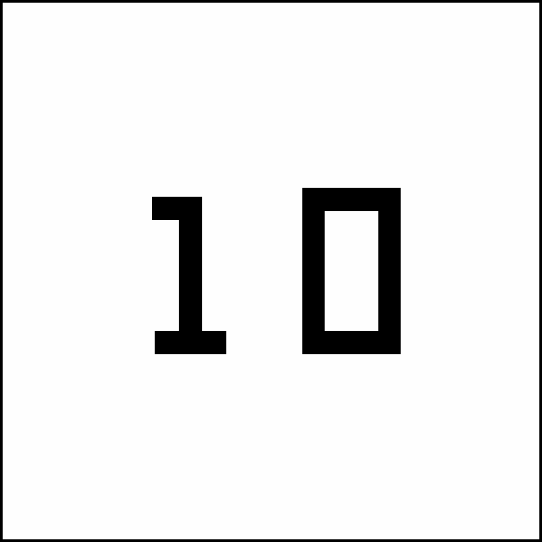
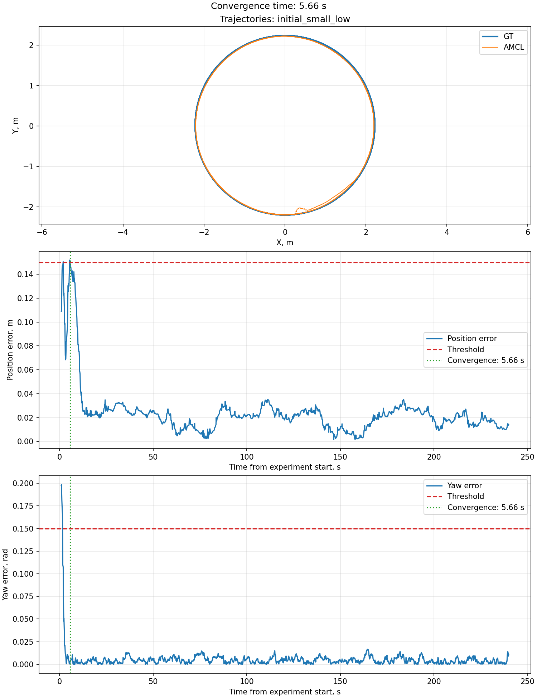
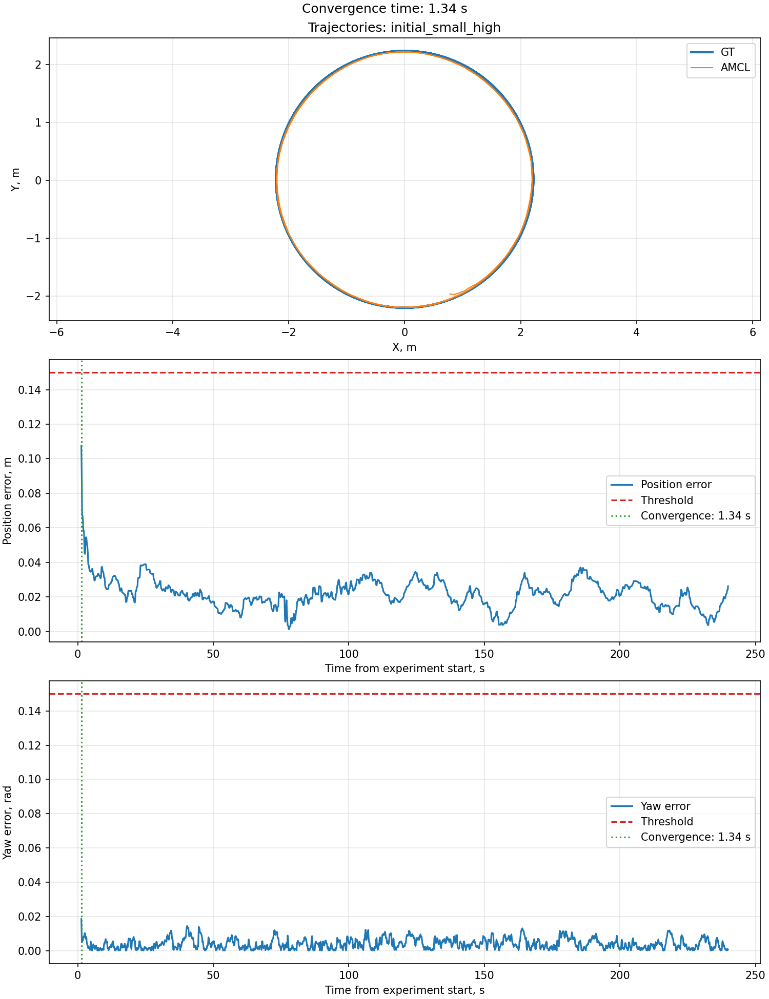
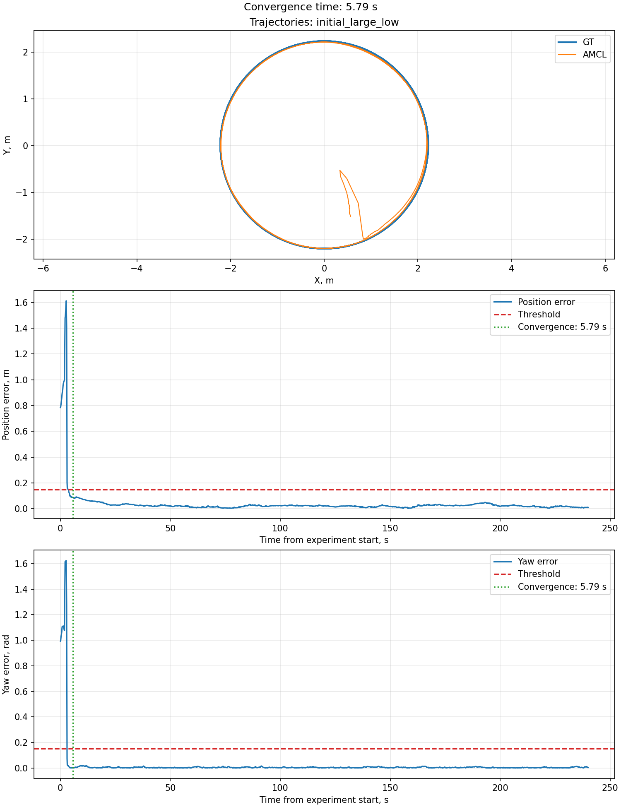
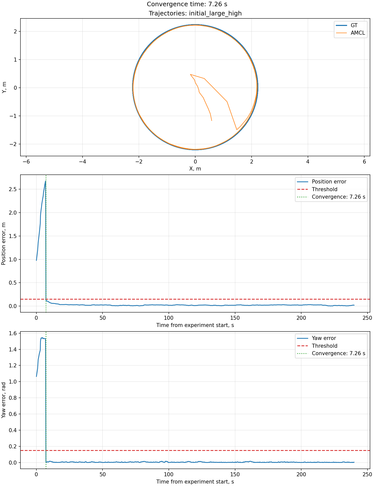
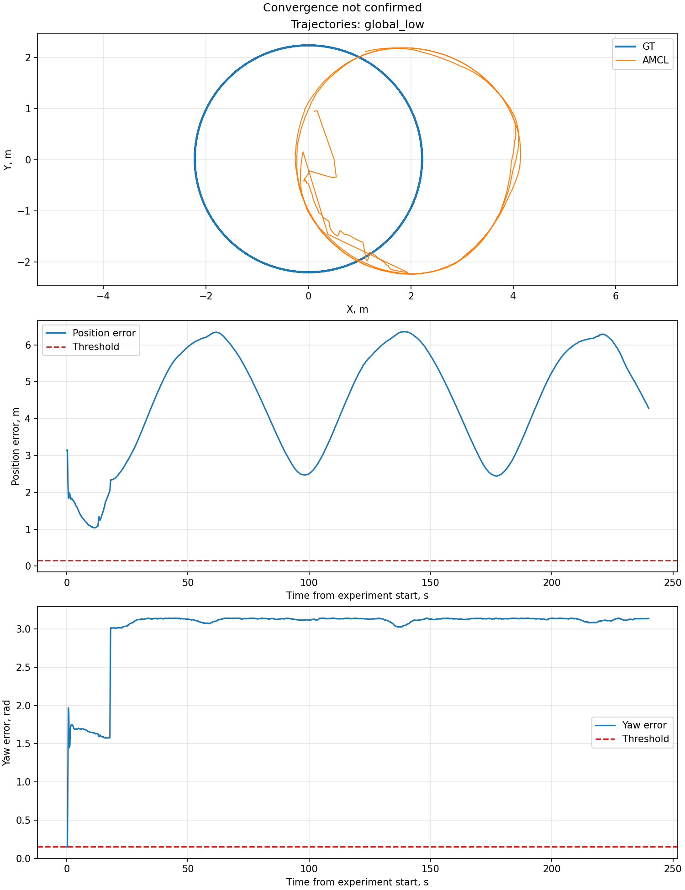
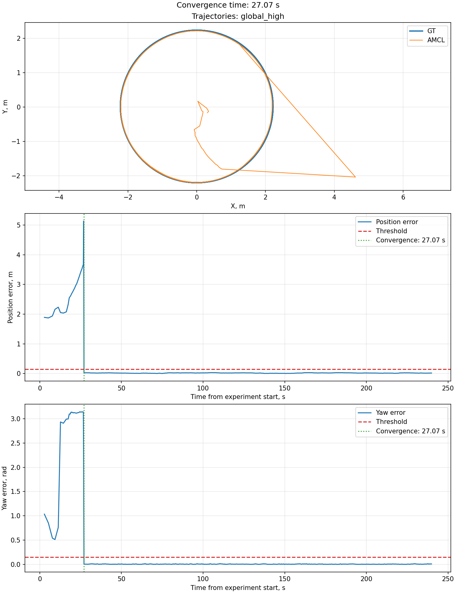

# Практическая работа 4 — вариант 10

Локализация TurtleBot3 Burger по известной карте в Webots с помощью AMCL.
Пакет `practice04_localization` создан на основе `examples/example_webots_localization`.

## Сцена и карта

Сцена `worlds/digits_10.wbt` содержит площадку 6 × 6 м со стенами и двумя
серыми неподвижными цифрами **1 и 0**. `DigitOne.proto` и `DigitZero.proto`
перенесены из решения практики 2. Высота цифр 0,4 м, стен 0,5 м; LiDAR видит
оба типа препятствий. Между цифрами оставлен проход шириной 0,85 м.

Цифры расположены в `(-0.9, 0, 0)` и `(0.9, 0, 0)`. Начальная истинная поза
робота во всех запусках: `x=0 м`, `y=-2.2 м`, `yaw=0 рад`.

Карта `maps/digits_10.pgm` с описанием `maps/digits_10.yaml` имеет размер
606 × 606 пикселей, разрешение 0,01 м/пиксель и начало `[-3.03, -3.03, 0]`.
Система `map` совпадает с глобальной ENU-системой сцены. Изображение включает
стены и горизонтальные сечения блоков цифр. Верх изображения соответствует
положительному направлению Y. Геометрия препятствий одинакова на всей высоте
сканирования LiDAR.



Карта подготовлена по известным координатам блоков сцены. Для её повторного
создания из папки `practices/practice-04`:

```bash
python3 scripts/generate_map.py
```

При изменении геометрии нужно также изменить координаты в генераторе карты
и пересобрать пакет.

## Сборка

Используется подготовленное окружение курса: ROS2 Jazzy и Webots R2025a.
Запуск Docker и подключение графики описаны в [инструкции курса](../../README.md).
Зависимости перечислены в `package.xml`, для графиков используется `matplotlib`.

Следующие команды выполняются внутри контейнера в Bash. Каталог `practices/`
репозитория подключён к `~/practices_ws/src/`.

```bash
source /opt/ros/jazzy/setup.bash
cd ~/practices_ws
colcon build --packages-select practice04_localization
source install/setup.bash
cd src/practice-04
```

## Единый запуск

```bash
ros2 launch practice04_localization spawn_robot.launch.py
```

Launch-файл запускает Webots, драйвер, контроллеры колёс, супервизор,
`map_server`, AMCL, RViz и программу эксперимента. Отдельные узлы вручную
запускать не требуется.

Программа дожидается активации AMCL и появления одометрии. При `initial`
публикуется начальная поза, при `global` вызывается сервис глобальной
локализации. Затем в `/cmd_vel` с частотой 10 Гц передаются постоянные команды
`v=0.176 м/с`, `ω=0.08 рад/с`. Робот движется по окружности радиусом примерно
2,2 м вокруг обеих цифр. За 240 с он проходит около трёх кругов.

Супервизор публикует истинную позу в `map -> base_link_gt`. Оценка AMCL
получается через `map -> odom -> base_link`. Статический `map -> odom` не
публикуется. Для сравнения обе позы запрашиваются через TF2 на один момент
времени симуляции.

Начало отсчёта `t0` — получение первой оценки с временной меткой после
завершения инициализации AMCL. Для каждого измерения сохраняются истинная
поза, оценка, ошибка положения и абсолютная минимальная разность углов.

Обе ошибки должны непрерывно оставаться в заданных пределах в течение
`confirmation_time`. При превышении любого порога или разрыве измерений
более 0,3 с подтверждение начинается заново. Время сходимости — начало первого
подтверждённого интервала относительно `t0`, а не момент его подтверждения.

По окончании эксперимента робот останавливается, сохраняются CSV с данными,
JSON с параметрами и временем сходимости и PNG с тремя графиками. После
сохранения запуск завершается автоматически. Если сходимость не подтверждена,
в JSON записывается `null`, а на графике и в терминале выводится сообщение.

## Параметры экспериментов

| Параметр | Значение |
|---|---|
| Продолжительность после `t0` | 240 с симуляции |
| Порог ошибки положения | 0,15 м |
| Порог ошибки угла | 0,15 рад |
| Подтверждение сходимости | 10 с |
| Малый режим частиц | `min_particles=500`, `max_particles=1000` |
| Большой режим частиц | `min_particles=500`, `max_particles=10000` |
| Малая ошибка начальной догадки | `Δx=0.1 м`, `Δy=-0.1 м`, `Δyaw=0.2 рад` |
| Большая ошибка начальной догадки | `Δx=0.5 м`, `Δy=0.5 м`, `Δyaw=1.0 рад` |

Ошибки прибавляются к истинной стартовой позе `(0, -2.2, 0)`. В режиме `global`
они не используются. Ковариация начальной догадки одинакова во всех запусках
с догадкой: дисперсии X и Y равны 0,25 м², yaw — 0,25 рад². Остальные настройки AMCL находятся
в `config/amcl.yaml` и одинаковы во всех шести запусках.

Пороги и время подтверждения выбраны после предварительных запусков:
при правильной локализации ошибки значительно меньше 0,15 м и 0,15 рад,
а неправильные глобальные гипотезы остаются за пределами порогов. Интервал
10 с исключает признание сходимости по кратковременному совпадению оценок.
Продолжительности 240 с достаточно для наблюдения нескольких оборотов.

## Шесть экспериментов

Команды выполняются по очереди из `~/practices_ws/src/practice-04`.
Каждая команда заново открывает сцену с одной и той же истинной стартовой позой.
Флаги `mode:=fast use_rviz:=false` использованы для сохранённых запусков:
время измеряется по симуляции, а не по часам компьютера.

Малая ошибка, малое число частиц:

```bash
ros2 launch practice04_localization spawn_robot.launch.py localization_mode:=initial error_x:=0.1 error_y:=-0.1 error_yaw:=0.2 min_particles:=500 max_particles:=1000 run_name:=initial_small_low mode:=fast use_rviz:=false
```

Малая ошибка, большое число частиц:

```bash
ros2 launch practice04_localization spawn_robot.launch.py localization_mode:=initial error_x:=0.1 error_y:=-0.1 error_yaw:=0.2 min_particles:=500 max_particles:=10000 run_name:=initial_small_high mode:=fast use_rviz:=false
```

Большая ошибка, малое число частиц:

```bash
ros2 launch practice04_localization spawn_robot.launch.py localization_mode:=initial error_x:=0.5 error_y:=0.5 error_yaw:=1.0 min_particles:=500 max_particles:=1000 run_name:=initial_large_low mode:=fast use_rviz:=false
```

Большая ошибка, большое число частиц:

```bash
ros2 launch practice04_localization spawn_robot.launch.py localization_mode:=initial error_x:=0.5 error_y:=0.5 error_yaw:=1.0 min_particles:=500 max_particles:=10000 run_name:=initial_large_high mode:=fast use_rviz:=false
```

Глобальная локализация, малое число частиц:

```bash
ros2 launch practice04_localization spawn_robot.launch.py localization_mode:=global min_particles:=500 max_particles:=1000 run_name:=global_low mode:=fast use_rviz:=false
```

Глобальная локализация, большое число частиц:

```bash
ros2 launch practice04_localization spawn_robot.launch.py localization_mode:=global min_particles:=500 max_particles:=10000 run_name:=global_high mode:=fast use_rviz:=false
```

Общие параметры можно явно задать как `duration:=240.0 position_threshold:=0.15
angle_threshold:=0.15 confirmation_time:=10.0`. Каталог задаётся через
`results_dir`, по умолчанию это `results` внутри текущей папки. Повторный запуск
с тем же `run_name` заменяет его файлы.

Для наблюдения в RViz или записи видео уберите `mode:=fast use_rviz:=false`
из выбранной команды. В RViz отображаются карта, сканы, частицы, оценка позы
и системы координат GT и AMCL. Красные точки лидара при правильной локализации
должны совпадать с чёрными препятствиями карты. После завершения откройте PNG
соответствующего запуска из `results`.

## Результаты

В `results` сохранены по одному CSV, JSON и PNG для каждой комбинации,
а также общая таблица `summary.csv`. Для каждого опыта выполнен один запуск.
Все шесть запусков используют одну сцену, карту, движение и настройки AMCL;
меняются только инициализация, её ошибка и границы числа частиц.

| Запуск | Инициализация | Ошибка догадки | min / max частиц | Сходимость, с |
|---|---|---|---|---|
| `initial_small_low` | Начальная догадка | Малая | 500 / 1000 | 5,66 |
| `initial_small_high` | Начальная догадка | Малая | 500 / 10000 | 1,34 |
| `initial_large_low` | Начальная догадка | Большая | 500 / 1000 | 5,79 |
| `initial_large_high` | Начальная догадка | Большая | 500 / 10000 | 7,26 |
| `global_low` | Глобальная | Без догадки | 500 / 1000 | Не подтверждена за 240 с |
| `global_high` | Глобальная | Без догадки | 500 / 10000 | 27,07 |













## Анализ

При малой ошибке начальной догадки сходимость достигнута за 5,66 и 1,34 с.
При большой ошибке получены времена 5,79 и 7,26 с. Запуск `initial_small_low`
повторён при записи видео; в отчёте и таблице приведён результат этого запуска.
После сходимости средняя ошибка положения за последние 20 с в этих четырёх
запусках составила примерно 0,01–0,015 м, а угла — 0,002–0,004 рад.

В глобальном запуске с максимумом 1000 частиц фильтр выбрал неверную гипотезу
и не исправил её за время опыта. В конце сохранялись большие ошибки:
средние за последние 20 с — около 5,49 м и 3,12 рад. Такой результат не считается
сходимостью, даже если сами частицы сосредоточились в небольшой области.

При максимуме 10000 частиц глобальная локализация сошлась за 27,07 с.
За последние 20 с средние ошибки составили около 0,019 м и 0,004 рад.
В этом запуске большее начальное множество частиц позволило сохранить
подходящую гипотезу до её подтверждения измерениями LiDAR.

При малой ошибке увеличение максимума частиц сократило время сходимости
в сохранённых запусках, а при большой ошибке — не сократило. По одному опыту нельзя делать вывод, что большее число
частиц всегда ускоряет или замедляет работу: AMCL использует случайные
выборки, а фактическое число частиц адаптируется между заданными границами.
При повторении результаты могут отличаться.

По истинным траекториям робот прошёл около трёх полных кругов вокруг цифр
в каждом опыте. Карта и геометрия сцены согласованы: при проверке с истинной
позой около 99,7% конечных точек LiDAR находились не дальше 5 см от препятствий
карты. При глобальной инициализации несовпадение сканов с картой до сходимости
связано с ошибкой оценки позы.

## Видеозапись

[PS, Практика 4, Мухаметов Арсений](https://drive.google.com/file/d/1EuBpRrxWSRuh5P30GUoTJqFOputA89t2/view?usp=drivesdk)
